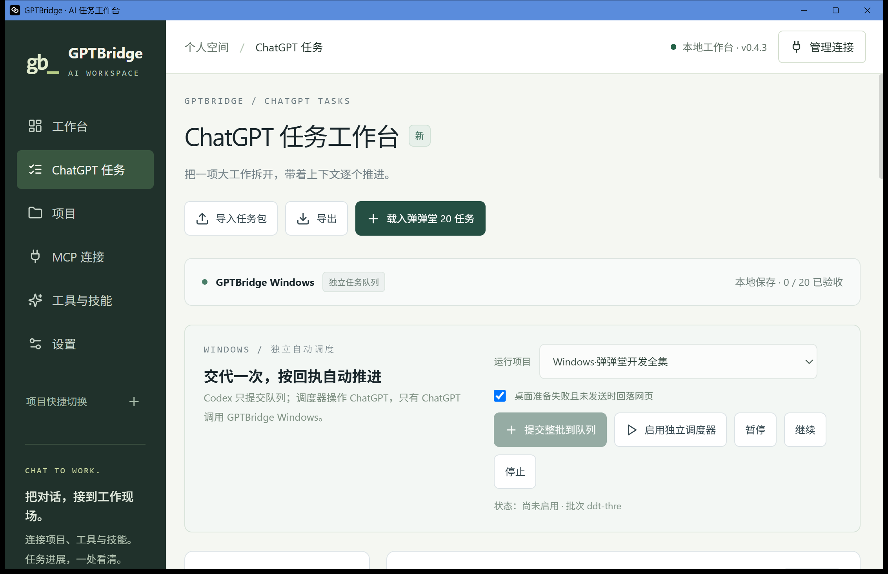

# Windows 调度启动修复交付

2026-10-22。用户点击启用后，旧候选因 `Ubuntu-24.04` 包含点号而被路径校验拒绝，实际没有启动调度器。已修复、推送并安装新 Windows 候选；原来的 20 任务队列保持不变。

最终功能源码 `167ed873c2a1e2e924b34119ffbdbe9b10d712b9`，Windows [构建 39757521093](https://github.com/lixiangwelding/GPTBridge/actions/runs/39757521093) 全部通过：19 项 Node、12 项 Python、3 项 Rust 路径测试实际通过，非全量 Rust 测试。Svelte、前端构建、PowerShell 语法、Rust 测试目标编译与 NSIS 构建通过。安装退出 0，新进程正常，安装时配置 SHA 不变，Windows MCP 本机界面恢复监听 38766。

本机可见 ChatGPT.exe 实际在 OpenAI.Codex 安装目录。新增镜像身份检查，拒绝把 Codex 内置 ChatGPT 当独立客户端；在选择新聊天和填入之前拦截。离线测试及 Windows CI 验证了 Codex 路径拒绝、独立 ChatGPT 路径接受，未执行发送器。

保留 Codex 禁令和队列交接例外。Codex 左上角 ChatGPT 模式不改变规则适用宿主；独立 Windows 调度器控制独立 ChatGPT 或 chatgpt.com 网页。旧启用没有成功，修复后用户需在 GPTBridge 中重新独立启用；Codex 没有代点。当前心跳和执行记录仍为空，20 项业务未开始。Mac 未访问或修改，67 个其他聊天文件哈希未变。完整构建、制品和安装身份见 delivery.json。

尚未验证：修复后用户实际启用、真实模型和思考强度菜单、真实消息发送和 GPTBridge 调用、业务任务完成。独立客户端缺失时允许未发送前回落网页；未知发送保留原请求，不重发。
